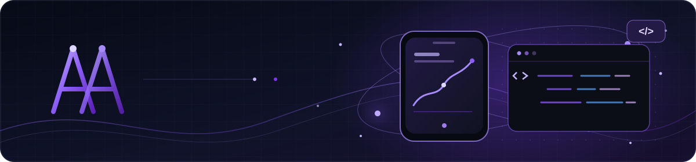
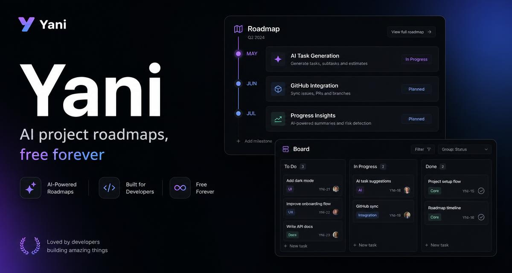
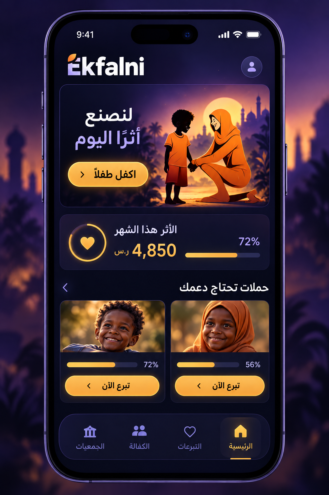
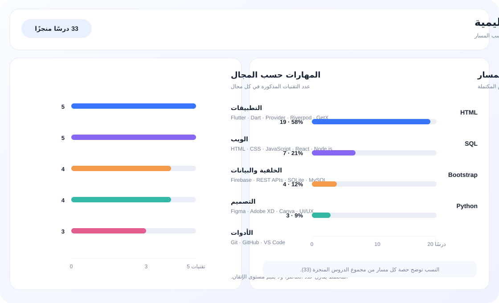

# أشجان العجيلي

### `@ashjanalajeeli`

**Flutter & Dart Developer · UI/UX Designer**

أصمّم واجهات واضحة وأطوّر تجارب رقمية للويب والهواتف، من الفكرة الأولى إلى منتج متناسق وسهل الاستخدام.

  
  
  
  

---

## 01 / نبذة

أجمع بين التصميم والبرمجة لبناء واجهات هادئة وتجارب استخدام عملية. أركّز على تطبيقات **Flutter** للويب والهواتف، وأحوّل الأفكار إلى منتجات رقمية متناسقة بصريًا ووظيفيًا.

## 02 / المكدس التقني

أدوات وتقنيات أعمل بها في التصميم، التطوير، والبيانات.

<table>
  <tr>
    <td align="center" width="10%"> Flutter</td>
    <td align="center" width="10%"> Dart</td>
    <td align="center" width="10%"> Firebase</td>
    <td align="center" width="10%"> REST APIs</td>
    <td align="center" width="10%"> SQLite</td>
    <td align="center" width="10%"> MySQL</td>
    <td align="center" width="10%"> Figma</td>
    <td align="center" width="10%"> Git</td>
    <td align="center" width="10%"> GitHub</td>
    <td align="center" width="10%"> VS Code</td>
  </tr>
</table>

## 03 / منصات الويب

مشاريع الويب والمنصات الرقمية.

<table>
  <tr>
    <td width="50%" valign="top">
      
      <h3>Yani</h3>
      
منصة ذكية لإدارة مشاريع البرمجة، تحوّل فكرة المشروع وملفاته إلى تحليل وRoadmap ومهام قابلة للتنفيذ.

      
<strong>الأدوات المستخدمة</strong>

      

        
        
        
        
        
        
      

      <a href="https://github.com/ashjanalajeeli/yani-follow-projects">↗ استكشف المشروع</a>
    </td>
    <td width="50%" valign="top">
      <h3>Marketing</h3>
      
مشروع محتوى وتوثيق تسويقي منظّم بهوية بصرية هادئة وتسلسل واضح.

      
<strong>الأدوات المستخدمة</strong>

      

        
        
        
      

      <a href="https://github.com/ashjanalajeeli/marketing">↗ استكشف المشروع</a>
    </td>
  </tr>
</table>

## 04 / التطبيقات

تطبيقات الهاتف والمنصات المستهدفة.

<table>
  <tr>
    <td width="50%" valign="top">
      
      <h3>Ekfalni</h3>
      
تطبيق لإدارة كفالة الأيتام والتبرعات، مع دعم العربية والإنجليزية وتجربة استخدام واضحة.

      

        
        
      

      
<strong>الأدوات المستخدمة</strong>

      

        
        
        
        
        
      

      <a href="https://github.com/ashjanalajeeli/ekfalninew">↗ استكشف المشروع</a>
    </td>
  </tr>
</table>

## 05 / التعلّم بالأرقام

## 06 / لنتواصل

<table>
  <tr>
    <td valign="middle" width="70%">
      <strong>هل لديك فكرة أو فرصة تعاون؟</strong> 
      أنا منفتحة على الفرص الجديدة، التعاونات، والأفكار الممتعة.
    </td>
    <td align="right" valign="middle" width="30%">
      
    </td>
  </tr>
</table>

  
  
  

تفاصيل مدروسة · واجهات هادئة · تجارب رقمية متناسقة

