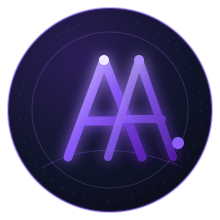

<table>
  <tr>
    <td width="25%" valign="top">
      

         
        
        <h2>أشجان العجيلي</h2>
        
<code>@ashjanalajeeli</code>

        
<strong>Flutter & Dart Developer UI/UX Designer</strong>

        
أصمّم وأطوّر تجارب رقمية واضحة للويب والهواتف.

         
        
          
        
          
        
          
        
          
        
           
        Code&nbsp;&nbsp;×&nbsp;&nbsp;Design 
        Better Experiences
      

    </td>
    <td width="75%" valign="top">

# أشجان العجيلي

### `@ashjanalajeeli`

**Flutter & Dart Developer · UI/UX Designer**

أصمّم واجهات واضحة وأطوّر تجارب رقمية للويب والهواتف، من الفكرة الأولى إلى منتج متناسق وسهل الاستخدام.

  
  
  
  

---

## 01 / نبذة

أجمع بين التصميم والبرمجة لبناء واجهات هادئة وتجارب استخدام عملية. أركّز على تطبيقات **Flutter** للويب والهواتف، وأحوّل الأفكار إلى منتجات رقمية متناسقة بصريًا ووظيفيًا.

## 02 / المكدس التقني

أدوات وتقنيات أعمل بها في التصميم، التطوير، والبيانات.

<table>
  <tr>
    <td align="center" width="10%"> Flutter</td>
    <td align="center" width="10%"> Dart</td>
    <td align="center" width="10%"> Firebase</td>
    <td align="center" width="10%"> REST APIs</td>
    <td align="center" width="10%"> SQLite</td>
    <td align="center" width="10%"> MySQL</td>
    <td align="center" width="10%"> Figma</td>
    <td align="center" width="10%"> Git</td>
    <td align="center" width="10%"> GitHub</td>
    <td align="center" width="10%"> VS Code</td>
  </tr>
</table>

## 03 / مشاريع مختارة

<table>
  <tr>
    <td width="33%" valign="top">
      
      <h3>Ekfalni</h3>
      
تطبيق Flutter للكفالة والتبرعات، بواجهة تركّز على الوضوح وسهولة الوصول للمبادرات.

      
<code>Flutter</code> <code>Dart</code> <code>UI/UX</code>

    </td>
    <td width="33%" valign="top">
      <h3>Marketing</h3>
      
مساحة توثيق ومحتوى تسويقي منظّمة بهوية بصرية هادئة، مع اهتمام بالتسلسل والوضوح.

      
<code>Content</code> <code>Design</code> <code>README</code>

      <a href="https://github.com/ashjanalajeeli/marketing">↗ استكشف المشروع</a>
    </td>
    <td width="33%" valign="top">
      <h3>المشاريع القادمة</h3>
      
أعمل على تجارب جديدة تجمع بين تطبيقات الهاتف، الواجهات العملية، والتفاصيل البصرية المدروسة.

      
<code>Build</code> <code>Design</code> <code>Improve</code>

    </td>
  </tr>
</table>

## 04 / التعلّم بالأرقام

## 05 / لنتواصل

<table>
  <tr>
    <td valign="middle" width="70%">
      <strong>هل لديك فكرة أو فرصة تعاون؟</strong> 
      أنا منفتحة على الفرص الجديدة، التعاونات، والأفكار الممتعة.
    </td>
    <td align="right" valign="middle" width="30%">
      
    </td>
  </tr>
</table>

  
  
  

تفاصيل مدروسة · واجهات هادئة · تجارب رقمية متناسقة

    </td>
  </tr>
</table>
